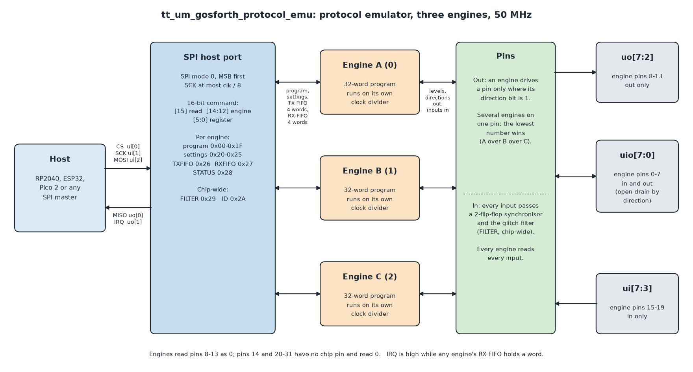
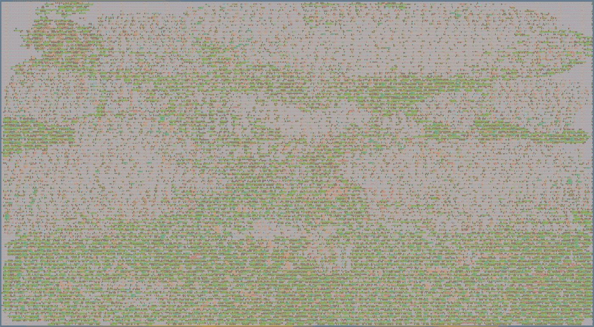

## How it works

The protocol emulator is three small programmable engines behind an SPI host port. Each engine runs its own
32-instruction program, one instruction per tick of its own clock divider, and drives or reads any of the chip's 19
protocol pins. Serial protocols (UART, SPI, I2C, NEC infrared, DALI and others) are programs, not fixed hardware. A
host microcontroller loads the programs and settings, pushes data to the engines and reads results back, all through
four SPI wires and an interrupt line.

Every instruction takes an exact, known number of ticks, so a program sets the timing of the wire it drives. The same
engines measure: an instruction-level stopwatch (`TIME`) gives the length of a pulse, a bit or a gap in ticks, and
`WAIT` can give up after a set number of ticks. Every input passes a programmable glitch filter.

The engine style follows the Raspberry Pi RP2040's PIO state machines and Texas Instruments' PRU (programmable
real-time unit): seven of the eight instructions take PIO's shape (`JMP`, `WAIT`, `IN`, `OUT`, `PUSH`/`PULL`, `MOV`,
`SET`, with side-set and program wrap); the eighth, `TIME`, is the stopwatch.

The design, its reference model, test benches, engine programs and bench records are in the design repository,
[github.com/markstanners1-arch/protocol-asic](https://github.com/markstanners1-arch/protocol-asic). This page
describes the chip as submitted here: three engines, instruction set v0.2, host port v0.2.



### At a glance

| Item | Value |
|---|---|
| Engines | 3 (A, B, C, numbered 0-2) |
| Program memory | 32 x 16-bit words per engine, written by the host while the engine is stopped |
| Instructions | 8 (instruction set v0.2) |
| Engine tick | one every `clkdiv + 1` chip clocks, `clkdiv` 16 bits: 20 ns to 1.31 ms at 50 MHz |
| FIFOs | 4 x 16-bit words each way per engine (host to engine, engine to host) |
| Protocol pins | 8 in/out (`uio[7:0]`), 6 out (`uo_out[7:2]`), 5 in (`ui_in[7:3]`) |
| Input conditioning | 2-flip-flop synchroniser and a glitch filter on every input |
| Host interface | SPI mode 0, 16-bit command and 16-bit words, SCK at most clk / 8; IRQ output |
| Clock | 50 MHz |
| Process | IHP SG13 CMOS5L (130 nm), Tiny Tapeout 6x4 tiles |

### What a program sees

Each engine has these registers, all visible to its program:

| Name | Bits | Use |
|---|---|---|
| `x`, `y` | 16 each | scratch values and loop counters; `y` also counts `WAIT` timeouts |
| `osr` | 16 | output shift register: words from the host are pulled into it and shifted out to pins |
| `isr` | 16 | input shift register: bits from pins are shifted in and the word pushed to the host |
| stopwatch | 16 | counts ticks while running; saturates at 65535 |
| pins | 32 | the engine's view of 32 pin numbers: an output level and a direction for each (1 = drive) |

Pin numbers run 0-31 and wrap. On this chip engine pins 0-7 are `uio[0..7]`, 8-13 are `uo_out[2..7]` and 15-19 are
`ui_in[3..7]`. Engines read pins 8-13 as 0; pins 14 and 20-31 have no chip pin and read 0.

The host sets these per engine before starting it (register addresses are in the host port table below):

| Setting | Meaning |
|---|---|
| `clkdiv` | the engine ticks once every `clkdiv + 1` chip clocks |
| `start` | first instruction after the engine starts |
| `wrap_bottom`, `wrap_top` | after the instruction at `wrap_top` (unless it jumped), continue at `wrap_bottom`: a loop with no jump instruction |
| `out_base`, `out_count` | pins written by `OUT pins` and `MOV pins`: `out_count` (0-16) pins from `out_base` up |
| `set_base`, `set_count` | pins written by `SET pins` and `SET pindirs`: `set_count` (0-5) pins from `set_base` up |
| `side_base`, `side_count` | side-set pins (0-2 of them) |
| `side_opt` | side-set is optional: instructions without `side N` leave the side pins alone |
| `side_dir` | side-set writes the side pins' directions instead of their levels (open drain) |
| `in_base` | `IN pins` and `MOV x, pins` read from here up; relative `WAIT` pins count from here |
| `jmp_pin` | the pin tested by `JMP pin` |
| `out_right`, `in_right` | shift direction: 1 = right (LSB first, as UART), 0 = left (MSB first, as SPI and I2C) |
| `fault_addr` | where a timed-out `WAIT` jumps to |

### Instruction word and timing

```
 15 14 13 | 12 11 10 9 8 | 7 6 5 4 3 2 1 0
  opcode  | side + delay  |   arguments
```

The five middle bits hold, from the top: the side-set enable bit (only when `side_opt` is set), then `side_count` bits
of side-set value, then the delay. With no side-set an instruction can add up to 31 delay ticks; with one optional
side-set pin, up to 7.

- An engine does one step per tick. A step either counts down a delay or executes the next instruction.
- An instruction that completes takes 1 tick, plus its delay field in extra ticks.
- Side-set pins take their value when the instruction first executes, even if it then stalls. If an instruction and
  the side-set write the same pin, the side-set wins.
- A stalled instruction (`WAIT` not met, `PULL` on an empty FIFO, `PUSH` on a full one) is tried again every tick; its
  delay starts only once it completes.
- After the instruction at `wrap_top`, the engine goes to `wrap_bottom` unless the instruction jumped.
- A running stopwatch counts every tick, stalls and delays included.
- Inputs reach the engines 5 chip clocks after they change at the pin with the filter at its shortest setting
  (`FILTER` = 0); a longer filter setting adds its hold time. The delay is the same for rising and falling edges, so
  measured widths are not changed by it. For the first clocks after reset every input reads 0, so a program that looks
  for a falling edge first waits for the idle level.

### The eight instructions

| Op | Instruction | Fields | What it does |
|---|---|---|---|
| 0 | `JMP` | `[7:5]` condition, `[4:0]` address | Jump if the condition holds: always; `!x` (x = 0); `x--` (x not 0, then x decrements either way); `!y`; `y--`; `x!=y`; `pin` (`jmp_pin` high); `!osre` (OSR not empty) |
| 1 | `WAIT` | `[7]` level, `[6]` timeout, `[5]` relative, `[4:0]` pin | Stall until the pin is at the level. Relative pins count from `in_base`. With timeout set: on each tick spent waiting, if `y` = 0 jump to `fault_addr`, otherwise decrement `y` |
| 2 | `IN` | `[7:5]` source, `[4:0]` bit count (0 = 16) | Shift the low n bits of the source into the ISR. Sources: pins, `x`, `y`, zeros, `isr`, `osr`, stopwatch |
| 3 | `OUT` | `[7:5]` destination, `[4:0]` bit count (0 = 16) | Shift n bits out of the OSR to: pins, `x`, `y`, pin directions, `pc` (a computed jump), `isr` |
| 4 | `PUSH` / `PULL` | `[7]` pull, `[6]` if-full / if-empty, `[5]` block | `PUSH`: ISR to the RX FIFO, ISR cleared. `PULL`: TX FIFO to the OSR; a non-blocking pull from an empty FIFO copies `x` instead. Block = stall until there is room or data |
| 5 | `MOV` | `[7:5]` destination, `[4:3]` op, `[2:0]` source | Copy, invert or bit-reverse a source into pins, `x`, `y`, `pc`, `isr` or `osr`. Sources: 16 pins from `in_base`, `x`, `y`, zero, stopwatch, status (TX FIFO level in bits 3:0, RX in 7:4), `isr`, `osr` |
| 6 | `SET` | `[7:5]` destination, `[4:0]` value | Write a 5-bit value to `set_count` pins, their directions, `x` or `y` |
| 7 | `TIME` | `[7:5]` action | Stopwatch: start (from 0), stop, capture into `x`, into `y`, or into the ISR ready to push. Capture does not stop it |

The stopwatch adds 1 on each tick before the instruction executes, so a capture gives exactly the number of ticks
since `time start`. At `clkdiv` 0 and 50 MHz that is 20 ns resolution over 1.31 ms; a larger `clkdiv` trades
resolution for range. The exact rules for every field, including the reserved encodings, are in
[`docs/isa.md`](https://github.com/markstanners1-arch/protocol-asic/blob/5041854c4bb51f166615acc507906e5db688fdf7/docs/isa.md) at the version this chip
was built from.

### Assembly language

Programs are written in a small assembly language and assembled by `model/asm.py` in the design repository:

```
label:
    opname args        [side N] [D]     ; comment
.side_set N [opt] [pindirs]             ; side-set width, optional enable, write directions
.wrap_target / .wrap                    ; mark wrap_bottom / wrap_top
```

The UART transmitter, the program the cocotb test loads, is five words. One bit is eight ticks, so the baud rate is
`f_clk / (8 x (clkdiv + 1))`:

```
.side_set 1 opt
    set    pindirs, 1   side 1          ; drive the TX pin, idle high
.wrap_target
    pull   block        side 1 [7]      ; wait for a byte; line high; this is also the stop bit
    set    x, 7         side 0 [7]      ; start bit: low for 8 ticks; 8 data bits to go
bitloop:
    out    pins, 1                      ; next data bit                (1 tick)
    jmp    x--, bitloop        [6]      ; loop                         (7 ticks) -> 8 per bit
.wrap
```

Assembled: `D881 9FA0 D727 6001 0643`.

### Open-drain buses

An open-drain line is driven by its direction bit, not its level: direction 1 with the level at 0 pulls the line low,
direction 0 lets the pull-up take it high. `SET pindirs`, `OUT pindirs` and, with `side_dir`, the side-set all write
directions, so I2C and other open-drain buses run from the engine pins with only pull-up resistors. Only `uio[7:0]`
(engine pins 0-7) can be both driven and read, so open-drain buses use those pins.

### Glitch filter

One chip-wide setting, register `FILTER` (0x29), applies to every input. A new input level must hold for N + 1
consecutive filter ticks, one filter tick every 2^P chip clocks, before the engines see it; a shorter pulse never gets
through. The delay is the same on rising and falling edges.

| N | P | Hold time at 50 MHz | Use |
|---|---|---|---|
| 0 | 0 | 20 ns | effectively off (the reset value) |
| 15 | 4 | about 5 µs | electrical spikes |
| 15 | 14 | about 5 ms | switch bounce |

### Host port

| Chip pin | Signal | Direction |
|---|---|---|
| `ui_in[0]` | CS, active low | in |
| `ui_in[1]` | SCK | in |
| `ui_in[2]` | MOSI | in |
| `uo_out[0]` | MISO | out |
| `uo_out[1]` | IRQ: high while any engine's RX FIFO holds a word | out |

SPI mode 0: SCK idles low, data is sampled on the rising edge, MSB first. MISO changes only just after a falling edge,
so a host may sample it anywhere between the rising edge and the next falling edge. The chip samples SCK with its own
clock, so SCK must be at most 1/8 of the chip clock (6.25 MHz at 50 MHz).

A transaction is CS low, a 16-bit command, any number of 16-bit words, CS high. The command is:

```
[15] 1 = read, 0 = write    [14:12] engine (0 = A, 1 = B, 2 = C)    [11:6] 0    [5:0] register
```

After each word the register number moves on by one, except for the two FIFO registers, which stay put, so a whole
program loads with one command and 32 words and a burst of data goes through one FIFO. On a read the chip sends each
word while the host clocks out zeros. An engine number past the last one is harmless: writes are ignored and reads
return 0.

| Reg | Name | R/W | Contents |
|---|---|---|---|
| 0x00-0x1F | PROG[0..31] | W | program memory; written only while the engine is stopped |
| 0x20 | CTRL | R/W | bit 0 RUN: 1 = run, 0 = stopped and held in reset |
| 0x21 | CLKDIV | R/W | 16 bits |
| 0x22 | WRAP | R/W | `[4:0]` start, `[9:5]` wrap_bottom, `[14:10]` wrap_top |
| 0x23 | OUTCFG | R/W | `[4:0]` out_base, `[9:5]` out_count (0-16), `[14:10]` set_base |
| 0x24 | MISC | R/W | `[2:0]` set_count, `[7:3]` side_base, `[9:8]` side_count, `[10]` side_opt, `[11]` out_right, `[12]` in_right, `[13]` side_dir |
| 0x25 | INCFG | R/W | `[4:0]` in_base, `[9:5]` jmp_pin, `[14:10]` fault_addr |
| 0x26 | TXFIFO | W | push a word to the engine (dropped if the FIFO is full: check STATUS) |
| 0x27 | RXFIFO | R | pop a word from the engine (reads 0 if empty) |
| 0x28 | STATUS | R | `[2:0]` TX level, `[6:4]` RX level, `[8]` running, `[13:9]` pc |
| 0x29 | FILTER | R/W | chip-wide, through any engine number: `[3:0]` N, `[7:4]` P |
| 0x2A | ID | R | chip-wide: `[7:4]` host port version (2), `[3:0]` number of engines (3), so 0x0023 |

Unlisted registers read 0 and ignore writes. Every setting resets to 0 with the chip, engines stopped. Settings are
changed while an engine is stopped and take effect when RUN goes to 1. A host push and an engine pull in the same clock
both happen, as do an engine push and a host pop.

### Pins shared between engines

Every engine can read every input. An engine drives a pin only where its direction bit is 1; if several engines drive
the same pin, the lowest-numbered wins (A over B over C). Stopping and reloading one engine does not disturb the
others: the engines share only the host port, the pin priority, the IRQ and the `FILTER` setting.

## How to test

### First contact

Any SPI master can drive the chip: on the Tiny Tapeout demo board, the RP2040 driving `ui_in[2:0]` and reading
`uo_out[1:0]`. Keep SCK at or below clk / 8. Byte sequences below are shown as they go out on MOSI.

1. **Read the ID register.** Send `80 2A 00 00`; the last two bytes back on MISO are `00 23`: host port version 2,
   three engines.
2. **Write and read back a setting.** `00 21 12 34` writes CLKDIV of engine A; `80 21 00 00` reads back `12 34`.
3. **Send a UART byte from engine A on engine pin 0 (`uio[0]`).**
   - Load the program: `00 00` then the words `D881 9FA0 D727 6001 0643` (the rest of the 32 words may be left as
     they are).
   - CLKDIV (0x21) = 53 for 115,741 baud at 50 MHz (0.5 % from 115,200), or 0 for a 6.25 Mbaud line that a
     simulation can decode.
   - WRAP (0x22) = 0x1020 (start 0, wrap 1 to 4); OUTCFG (0x23) = 0x0020 (out_base 0, out_count 1, set_base 0);
     MISC (0x24) = 0x0D01 (set_count 1, side-set 1 pin, optional, LSB first).
   - CTRL (0x20) = 1. STATUS (0x28) now reads with bit 8 set and `uio[0]` idles high.
   - Push a byte to TXFIFO: `00 26 00 55` sends 'U' as 8N1 on `uio[0]`.
4. **Read the glitch filter register through another engine number.** Write `00 29 00 2F`, read `90 29 00 00`: the
   same `00 2F` comes back, because FILTER is chip-wide.

The cocotb test in this repository (`test/test.py`) does steps 2 to 4 through the chip's pins only. To run it:

It needs Icarus Verilog and Python:

```sh
cd test
pip install -r requirements.txt
make -B
```

The same test runs on the gate-level netlist (`make -B GATES=yes`, after hardening) in the GitHub workflow.

The design repository has ready-made hosts: an ESP32 sketch (`esp32/chip_test`) and MicroPython for the Raspberry Pi
Pico 2 (`pico/chip_host.py` and the scripts beside it), each with the assembled programs and their entry labels.

### Engine programs that exist

All in `programs/` in the design repository, sizes from the assembler:

| Program | Words | Does |
|---|---|---|
| `uart_tx.asm` | 5 | UART 8N1 transmit, 8 ticks a bit |
| `uart_rx.asm` | 13 | UART 8N1 receive; the stop bit comes back in bit 8, so the host sees framing errors |
| `measure_baud.asm` | 7 | times a start bit with the stopwatch |
| `measure_pulse.asm` | 6 | times low pulses |
| `i2c_master.asm` | 19 | I2C master, open drain on both lines, clock stretching honoured; one host word per START, byte or STOP; every ACK reported |
| `i2c_sniff.asm` | 29 | watches an I2C bus and reports every byte with its ACK bit |
| `spi_master.asm` | 14 | SPI master, mode 0, MSB first |
| `keypad.asm` | 16 | 4x4 keypad scanner, open-drain columns, reports the 16-key map on change |
| `ir_nec.asm` | 29 | NEC infrared remote decoder, including repeat frames |
| `ir_tx.asm` | 31 | NEC infrared transmitter with a 38 kHz carrier made in software |
| `dali_tx.asm` | 13 | DALI forward frame transmitter, 1200 bit/s Manchester |
| `dali_rx.asm` | 26 | DALI backward frame receiver with listening window and framing errors |
| `read_pins.asm` | 3 | pushes the raw level of every pin (a bench check for leads) |
| `push_789.asm` | 10 | pushes 7, 8, 9 (used in the engine isolation test) |

### How it has been verified

The design is proven three ways after every change, and each new test is checked by planting a bug and seeing it fail.

- **Reference model.** `model/engine.py` is a clock-by-clock Python model of one engine, written from the instruction
  set rules; `model/glitch_filter.py` models the filter. Program-level tests run each protocol program on the model
  against a model partner device: UART against a fixed-function transmitter (every frame equal), I2C against a
  register-pointer slave with clock stretching, SPI against a model slave, NEC and DALI against model receivers and
  control gear at 0 and ±5 % timing.
- **Side-by-side random test.** `model/cosim.py` runs random programs (half of them fully random words), random
  settings, random pin activity and random host traffic on the model and on the Verilog together and compares the
  whole engine state on every clock: 1000 programs x 400 clocks per seed, with flip-flop program memory and with IHP's
  SRAM block as program memory. For instruction set v0.2: 400,000 random clocks identical on each build, with a planted
  `side_dir` bug caught in 71 of 200 programs. The filter is compared the same way (`model/cosim_filter.py`).
- **Whole-chip test.** `test/tb_chip.v` drives the chip only through its SPI pins, with a host sampling MISO early and
  one sampling late: settings read back, program writes while running ignored, UART from engine A at three rates with
  engine B measuring A's bit time exactly, a 30-clock glitch removed and a 200-clock pulse measured by the filter
  section, I2C master with a bench slave that stretches the clock and engine B watching the bus, the pin priority
  chain, the ID register, IRQ, and engine isolation (engine A hung on a `WAIT` while B and C carry on, then A reloaded
  and restarted alone). It passes with three engines and with two.
- **Planted bugs caught**, among others: five in the first engine; pin priority reversed; engine field taken from the
  wrong command bits; MISO shifting early; program writes accepted while running; I2C master ignoring clock stretching;
  every engine reset when one stops; stopping one engine popping every RX FIFO.
- **Tiny Tapeout flow.** The cocotb test passes on the RTL and on the gate-level netlist; the gds, precheck and
  viewer jobs pass for this commit's design.

### Shown on real hardware

The same Verilog has been built for FPGA boards and driven from a microcontroller host over the SPI host port:

| Board | Engines | Clock | Host |
|---|---|---|---|
| Lattice MachXO3L Starter Kit (LCMXO3L-6900C) | 2 (ID 0x0022) | 12 MHz | ESP32, then Raspberry Pi Pico 2 |
| Mojo v3 (Xilinx Spartan-6 XC6SLX9) | 3 (ID 0x0023) | 50 MHz, as on the chip | Raspberry Pi Pico 2 |
| Nandland Go Board (Lattice iCE40 HX1K) | host port and filter only | 25 MHz | ESP32 |

Results, each from a scripted run read back line by line:

| Protocol or measurement | Partner on the wire | Result |
|---|---|---|
| UART transmit | ESP32 serial input; Pico 2 UART | text received exactly at 115,200, 57,600 and 19,200 baud, on the MachXO3L (12 MHz) and on the Mojo (50 MHz) |
| Bit-time measurement | engine A's own UART line | engine B measured 104, 208 and 624 clocks at 12 MHz, and 432, 872 and 2,608 clocks at 50 MHz, for the three rates |
| UART receive | Raspberry Pi Pico 2 UART0 | all 256 byte values at 115,200; a 256-byte stream with no gaps at 9,600; loopback from engine A exact at 9,600 to 115,200; 0x55 sent at 4,800 baud into the 9,600 receiver: 6 of 7 flagged as framing errors |
| Baud rate measurement | Pico 2 UART at nine rates | every rate from 1,200 to 460,800 baud identified within 0.16 % (12 MHz clock) |
| I2C master | ESP32 as slave; Arduino UNO R3 as slave | bytes written and read back with every ACK right; the UNO stretches the clock and the master waits; read-back with STOP then START and with a repeated START |
| I2C master | AT24C256 EEPROM (32 KB) | probe, page write, write cycle timed by ACK polling (6 ms), sequential and random reads, the top of memory at 0x7FF0 written without disturbing the bottom, contents restored |
| I2C bus watcher | engine B on the same two wires as engine A | in every transaction to the EEPROM at 100 and 400 kHz, the watcher's bytes and ACK bits equalled what the master saw |
| I2C address scan, 0x08-0x77 | the same bus | the UNO slave found at 0x50 (ESP32 host); the AT24C256 found at 0x50 (Pico 2 host) |
| SPI master | 74HC595 shift register with LEDs | each transfer returned the previous byte through QH', 16 of 16 steps; engine B timed every SCK low at 60 clocks (100 kHz) |
| Glitch filter | ESP32 pulses on engine pin 15 | filter off: a 2 µs glitch measured 2.7 µs and a 20 µs pulse 21.1 µs; filter on (5.3 µs hold): glitch gone, pulse 21.0 µs; the same check passed on the Mojo at 50 MHz |
| Glitch filter (Go Board) | push switch, 84 presses | filter off, bounce got through; any setting from about 82 µs gave exactly one edge per press; measured delays within the design's range at four settings |
| SPI host port (Go Board) | ESP32 SPI master | 0 errors in 15,372 checks from 0.25 to 4 MHz on the 25 MHz board |
| 4x4 keypad | membrane keypad | a scripted sequence including two keys at once and two on one row read back exactly |
| NEC infrared receive | two handheld remotes via an IR receiver module | a 12-key scripted sequence decoded in order, with repeat frames; frame timing checked against a logic analyser capture |
| NEC infrared transmit | IR LED, received by the chip's own decoder | 6 of 6 frames came back exactly; logic analyser: carrier 38.46 kHz, leader 8.76 ms then 4.47 ms, every figure within 5 % of a real remote's frame |
| Engine isolation | none | engine A hung on a `WAIT` while the other engines carried on; A stopped, reloaded and restarted without disturbing them |
| I2C clock, outside check | oscilloscope on SCL | one SCL period 10.8 µs by cursors at a 100 kHz setting |

Scope pictures and logic analyser captures are in `docs/bench/` of the design repository, and the wiring of every run
is in `docs/bench_wiring.md`.

**DALI** (`dali_tx.asm`, `dali_rx.asm`) is proven on the model only: forward frames, answers after 2.9, 5.5 and 9.2 ms
at every phase of the engine's tick, control gear 5 % and 10 % fast and slow, coding violations reported, at 12 and
50 MHz. It has not been run on a DALI bus.

### Layout figures

From the Tiny Tapeout flow's three-engine layout run (IHP SG13 CMOS5L, 6x4 tiles, 50 MHz clock); the full table is
`docs/layout/metrics_3nov_v02_3eng.csv` in the design repository.

| Item | Value |
|---|---|
| Die | 1289.28 x 710.64 µm |
| Core area | 902,417 µm² |
| Standard cells | 30,221 (446,885 µm²) |
| Utilisation | 49.5 % |
| Flip-flops and other sequential cells | 2,969 |
| Setup, worst slack | 3.50 ns slow corner (1.08 V, 125 °C); 9.62 ns typical; 12.12 ns fast |
| Hold, worst slack | 0.095 ns fast corner (1.32 V, -40 °C); 0.27 ns typical; 0.58 ns slow |
| Setup and hold violations | 0 at all three corners |
| DRC | 0 (Magic and detailed routing) |
| LVS | 0 differences |
| Antenna | 0 violating nets (79 diodes inserted) |
| Warnings | 49 maximum-slew and 224 maximum-fanout, at the slow corner |
| Power, flow estimate | 10.9 mW |



## External hardware

- **A host:** any microcontroller with SPI mode 0 and one input for IRQ. The RP2040 on the Tiny Tapeout demo board
  will do; an ESP32 and a Raspberry Pi Pico 2 have been used. Keep SCK at or below 6.25 MHz for a 50 MHz chip clock.
- **For I2C and other open-drain buses:** pull-up resistors to 3.3 V on the bus lines, which go on engine pins 0-7
  (`uio`). 4.7 kΩ and 5.1 kΩ were used on the bench.
- **Something to talk to**, optional. Devices driven on the bench: a UART (another microcontroller), I2C slaves (ESP32,
  Arduino UNO R3, AT24C256 EEPROM), a 74HC595 shift register, a 4x4 membrane keypad (10 kΩ pull-ups on the rows), an
  NEC infrared receiver module and an IR LED.
- **Optional instruments:** a logic analyser or oscilloscope on the protocol pins.
